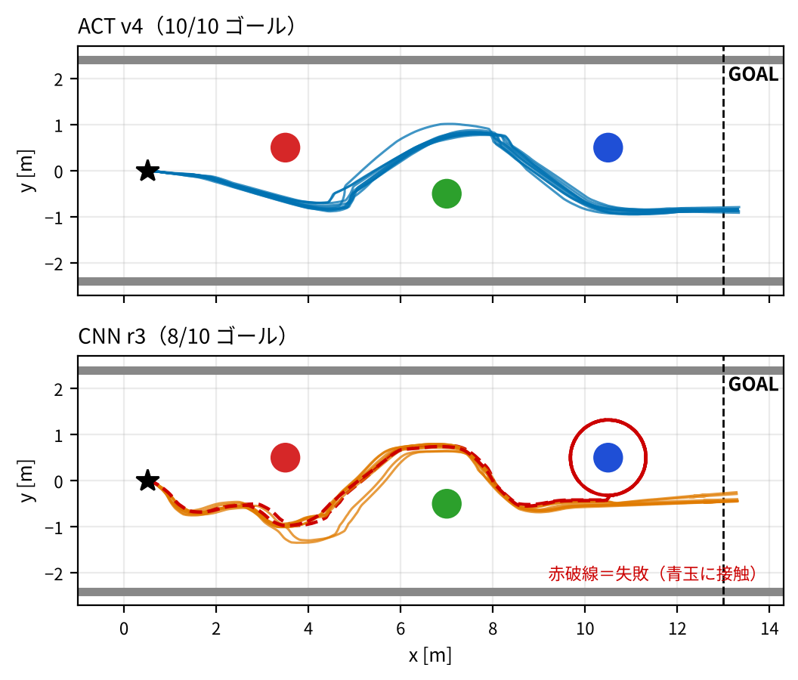

# 模倣学習を用いた、仮想Vehicleのスラローム走行

Physical AI 応用1講座 最終課題。Gazebo（Ignition Fortress）上の差動駆動車が、車載カメラの画像だけを入力に、赤→緑→青の球の間を左右交互にすり抜けてゴールまで走ります。人の手動操作を真似る模倣学習で、CNN と自作の簡易 ACT（Action Chunking with Transformers）を作り比較しました。

| モデル | 通常スタート（10回） | ずれた姿勢からの復帰（15姿勢） |
|---|---|---|
| CNN r3 | 8/10 ゴール（平均 34.6 秒） | 3/15 |
| **ACT v4（最終）** | **10/10 ゴール**（平均 33.2 秒） | **6/15** |



## 構成

```
.
├── src/
│   ├── nav_ai/                 # 模倣学習パッケージ（Python）
│   │   └── nav_ai/
│   │       ├── data_collector.py     # 手動走行の画像と操作を記録（CNN 用、連続形式）
│   │       ├── episode_collector.py  # 1走行=1エピソードで記録（ACT 用・復帰デモ用）
│   │       ├── train_driving.py      # CNN の学習（DrivingCNN の定義を含む）
│   │       ├── train_act.py          # 簡易 ACT の学習（ACTPolicy の定義を含む）
│   │       ├── drive_node.py         # CNN の推論ノード（安全層・スタック検出）
│   │       └── act_drive_node.py     # ACT の推論ノード（Temporal Ensembling）
│   └── nav_dev/                # シミュレーション環境（C++ / launch / world）
│       ├── world.sdf                 # コース（壁・球3つ・車・カメラ）
│       ├── launch/nav_teleop.launch.py   # use_teleop:=false で teleop を起動しない
│       ├── config/nav_teleop.yaml    # ros_gz_bridge の設定
│       └── src/teleop_node.cpp       # WASD 操作（講座配布）
├── act_model_v4_config.json      # 最終モデル ACT v4 の学習設定（重みは含まない）
├── driving_model_v2_config.json  # CNN r3 の学習設定（重みは含まない）
├── eval_run.py         # 自動評価（姿勢リセット→走行→真値の軌跡記録→判定・図）
├── start_sim.sh        # シミュレーション起動
├── shoot.sh            # 動画撮影用の走行（MODEL=cnn で CNN）
├── set_view.sh / reset_car.sh   # Gazebo の視点変更・車の位置リセット
├── batch_act4.sh       # ACT v4 の学習と通常スタート10回評価
├── batch_rec.sh        # 復帰評価（固定15姿勢 × CNN / ACT v3 / ACT v4）
├── logs/recovery_starts.csv     # 復帰評価の15姿勢
├── make_video_assets.py         # 動画用の図表を生成
└── docs/figures/       # 図
```

## 動作環境

- Ubuntu 22.04 / ROS 2 Humble / Gazebo（Ignition Fortress）、`ros_gz_bridge`
- Python：PyTorch・torchvision（CUDA 推奨）、OpenCV、numpy、pandas、matplotlib、Pillow
- 開発時は Windows + WSL2 + Docker（GPU：RTX 4070 SUPER）で実行
- キー入力に [nek009/key_event](https://github.com/nek009/key_event) を使用（`nav_dev` の依存）

## セットアップ

スクリプトはワークスペースを `~/ros2_ws` と仮定しています。

```bash
git clone <このリポジトリ> ~/ros2_ws
cd ~/ros2_ws/src && git clone https://github.com/nek009/key_event.git
cd ~/ros2_ws
source /opt/ros/humble/setup.bash
colcon build --symlink-install
source install/setup.bash
```

> `~/.bashrc` で別のワークスペースを読み込んでいる場合も、各スクリプトは `source /opt/ros/humble/setup.bash; source ~/ros2_ws/install/setup.bash` を明示しています。手動で実行するときも同様に読み込んでください。

## 使い方

### 1. シミュレーション起動

```bash
./start_sim.sh                 # teleop なし（自動走行・評価用）
USE_TELEOP=true ./start_sim.sh # WASD で手動操作（デモ収集用）
```

### 2. 学習済みモデルで走らせる

学習データと学習済みモデル（`.pth`）はリポジトリに含めていません。下の「4. デモ収集と学習」で作ったモデルを `~/ros2_ws` に置いて実行します。

```bash
# ACT v4（最終モデル）
ACT_MODEL=~/ros2_ws/act_model_v4.pth ACT_TE=1 ACT_TE_ORDER=new ACT_TE_M=0.5 \
  ros2 run nav_ai act_drive_node

# CNN r3
ros2 run nav_ai drive_node
```

### 3. 評価

```bash
# 通常スタート、制限80秒。結果は logs/eval_<ラベル>.png / .csv / .out
DRIVE_NODE=act_drive_node ACT_MODEL=~/ros2_ws/act_model_v4.pth \
  ACT_TE=1 ACT_TE_ORDER=new ACT_TE_M=0.5 python3 eval_run.py 80 test1

# 指定姿勢から（x, y, yaw[deg]）
EVAL_START="9.24,0.56,-81" DRIVE_NODE=drive_node python3 eval_run.py 60 rec14

./batch_rec.sh   # 復帰評価をまとめて実行（ACT v3 のモデルも必要）
```

`eval_run.py` は評価中、講座の teleop_node を一時停止（SIGSTOP）します。teleop_node はキーを押していない間もゼロ速度を送り続け、推論ノードの指令を打ち消すためです。中断したときは位置取得用のブリッジが残るので `pkill -f "[d]ynamic_pose/info"` で止めてください。

### 4. デモ収集と学習（再現する場合）

```bash
# ACT 用エピソード収集（USE_TELEOP=true で起動したシミュレーションで）
ros2 run nav_ai episode_collector                       # → dataset_act/
ACT_START=recovery ACT_DATASET_DIR=~/ros2_ws/dataset_recovery ros2 run nav_ai episode_collector   # 復帰デモ（ずれた姿勢からスタート）

# CNN 用（連続記録）
ros2 run nav_ai data_collector                           # → dataset/

# 学習
python3 src/nav_ai/nav_ai/train_driving.py dataset dataset.04          # CNN
ACT_AUG=1 ACT_FREEZE=layer2 ACT_EPOCHS=15 ACT_MODEL=act_model_v4.pth \
  python3 src/nav_ai/nav_ai/train_act.py dataset_act dataset_recovery dataset dataset.04   # ACT v4
```

## 手法の要点

- **CNN**：PilotNet 系。直近3フレーム（120×160）→「左／直進／右」3クラス＋前進速度。球の左右位置を残すため最終プーリングは 3×5。
- **簡易 ACT**：ResNet18（layer2 まで凍結）→ Transformer Enc/Dec 各2層 → 10ステップ先までの行動チャンク。推論では過去の予測を新しいもの重視で平均（Temporal Ensembling、重み exp(−0.5×経過フレーム)）。
- **共通の後処理**：クラス重みの割り戻し、球が正面に大きく写ったときの旋回強化（向きはモデルが行きたい側）、画像が変化しないときの後退・切り返し。

レポートは omnicampus に提出した説明資料（PDF）を参照してください。
